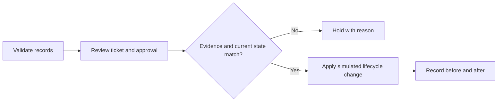

# Asset Lifecycle and Support Ticket Lab

What should happen when an employee leaves but a laptop is still assigned to them? This offline Python lab connects an asset register to support tickets and checks the evidence before changing a record.

**Status:** runnable AI-assisted learning resource, with assistant-produced test evidence. Personal learner completion is not claimed. All people, devices, identifiers, tickets and events are synthetic.

## Run it

Requires Python 3.10 or newer and the standard library only. From the repository root:

```sh
cd labs/asset-lifecycle
python asset_lab.py
python -m unittest -v
```

On Windows, `py -3` can be used instead of `python`. Each demo creates a new timestamped folder under `runs/` with a summary, audit report and simulated final state. The input fixture and previous results are preserved. No account, network service, subscription or real device is involved.

## What the fixture demonstrates

The sample contains 20 fictional users, 20 assets and five support requests.

| Ticket | Request | Expected result |
|---|---|---|
| T-001 | Deploy a stored asset to an active user | Apply the approved simulated change |
| T-002 | Change an assignment without an approver | Hold for review |
| T-003 | Recover an asset from a leaver | Move it to inspection/repair and clear its assignee |
| T-004 | Retire an asset without sanitization evidence | Hold for review |
| T-005 | Transfer an asset to a leaver | Hold for review |

The fixture produces two simulated changes and three holds. One leaver-assignment finding becomes zero. These are example outputs, not a measure of risk reduction in a real company. **Recovering equipment does not revoke account access.**



## Review the implementation

- [asset_lab.py](asset_lab.py): validates relationships and lifecycle states, checks separate requester/approver identities in the fixture, blocks stale or repeated requests, and writes an audit report.
- [test_asset_lab.py](test_asset_lab.py): ten tests covering expected outcomes, unchanged inputs, missing approvals, self-approval, inactive users, stale requests, replay, retirement evidence and invalid records.
- [sample_data.json](sample_data.json): inspectable synthetic input.
- [RUNBOOK.md](RUNBOOK.md): intake, verification, escalation and closure guidance.
- [Example report](examples/report.json): assistant-generated output, with [verification notes](examples/VERIFICATION.md).

## Make it your own

1. Predict all five outcomes before running. Explain the evidence behind each decision.
2. Copy `sample_data.json` to `learner_data.json`. Repair one held request using clearly fictional evidence and make another request stale.
3. Run `python asset_lab.py --input learner_data.json`. Compare the actual results with your predictions.
4. Record your changes and explanations in [LEARNER_EVIDENCE.md](LEARNER_EVIDENCE.md). Explain why equipment recovery and access removal require separate checks.

The learner record starts blank. Only describe activities you actually performed in a resume or interview.

## Limits and provenance

This is a small inventory simulation, not an enterprise CMDB, identity system or BMC/Intune integration. Approval strings are fictional inputs, not authenticated approval. The JSON audit is editable. The event timestamp is fixed for the scenario; the output folder records the actual run time. No device is wiped and no access is revoked.

The idea came from a CleverTailor junior IT operations project suggestion. The assistant wrote and tested this original offline adaptation. No employer systems, paid course assets or completed learner achievements are represented. See [SOURCES.md](SOURCES.md) for background and attribution.

MIT license: see the repository's [LICENSE](../../LICENSE).
